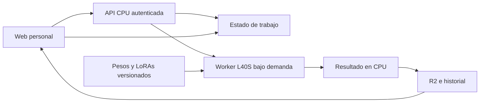

# Investigación y propuesta para el worker personal Krea2

Fecha de consulta: 15 de noviembre de 2026. Archivo auditado: `krea2_modal_v1-deepseek.py` (1598 líneas). También se inspeccionaron el manager CPU y las llamadas de la web. No se ejecutó ninguna GPU ni se desplegó nada. Las conclusiones de rendimiento son hipótesis para medir, no benchmarks realizados.

## Recomendación

Para este uso personal conviene un worker pequeño de **texto a imagen con LoRAs**, una API CPU para estado/resultados y GPU bajo demanda. Separar preview y final en dos trabajos independientes: la GPU no debe esperar a que el usuario mire la preview. Mantener un único modelo base por versión del despliegue, restaurable mediante snapshot si las mediciones confirman que ayuda.

El ahorro debe medirse por **costo total de una imagen que decidís conservar**, incluyendo arranque/restauración, LoRAs, generación, decodificación y tiempo ocioso. No por pasos por segundo exclusivamente.

Para priorizar apagar después de cada trabajo, la opción concreta actual es `single_use_containers=True` en una clase con método GPU de generación. Modal documenta cierre tras una entrada; no implica liberación física en cero milisegundos. La alternativa es permitir reutilización con `scaledown_window=2`. No confundir single-use con limitar concurrencia a uno. [Referencia oficial](https://modal.com/docs/sdk/py/latest/App).

Hay una LoRA específica de destilación a dos pasos para investigar; una LoRA de personaje común por sí sola no convierte Turbo en un buen modelo de dos pasos. Detalles y fuentes en [investigación Krea2](krea2-comfyui.md). Las reglas y costos de la plataforma están en [investigación Modal](modal-serverless.md).

## Problemas concretos del archivo

Estas observaciones provienen de lectura del código local, no de una ejecución remota.

| Prioridad | Ubicación | Hallazgo | Acción propuesta |
|---|---|---|---|
| Alta | 1475–1515 | El encabezado promete arranque menor a 10 s sin evidencia. Se permite continuar si falla warmup. | No declarar listo un snapshot sin una generación real válida y comprobación de recursos. |
| Alta | 759–790 | Aunque el nombre dice BF16, el loader intenta primero FP8 e4m3, luego e5m2. | Elegir precisión explícita y registrar la efectiva. Comparar BF16 contra un checkpoint FP8 escalado compatible. |
| Alta | 134–145, 1181–1195 | Precios heredados de Beam; el estimador solo suma etapas instrumentadas. | Retirar la etiqueta de costo real. Usar tarifa vigente y reconciliar con tiempo facturado de Modal. |
| Alta | 1483 | `scaledown_window=60`; el comentario inicial dice 300. | Eliminar contradicción; usar la política de apagado breve o un input por contenedor detallada en el informe Modal. |
| Alta | 313–325 | A los 300 s se cambia el estado a IDLE sin detener el trabajo CUDA o hilo anterior. | No liberar exclusión por reloj: podría dejar entrar otra generación mientras la anterior sigue. Cancelación real o fallo del contenedor. |
| Alta | 1128–1147, rutas finales | Si falla R2 devuelve `/serve_image`, pero este worker no implementa esa ruta. | Persistir y servir resultados desde CPU/R2, o devolver bytes utilizables. No publicar una URL inexistente. |
| Media | 63–119 | ComfyUI y custom nodes se clonan desde ramas móviles; dependencias sin fijar; instalaciones repetidas y errores ocultos con `|| true`. | Fijar commits y versiones compatibles. Instalar una vez y fallar si falta una dependencia necesaria. |
| Media | 679–713 | Intenta desactivar offload mediante atributos que no aparecen en el `model_management.py` actual consultado. | Configurar las opciones soportadas antes de importar Comfy. No asumir que esos `hasattr` hacen algo. |
| Media | 725–746 | Reemplaza globalmente SDPA por Sage y hace fallback silencioso por llamada. | Usar integración oficial y registrar backend real. Comparar salida, latencia y estabilidad. |
| Media | 1014–1023 | Aplica `ModelSamplingFlux` con shift dependiente de resolución y oculta errores. | Verificar receta exacta de Turbo/LoRA. Para fixed shift 1.15, una posibilidad es igualar base/max en el nodo; comprobar contra workflow del autor. |
| Media | 889–901 | Codifica también el negativo incluso con CFG=1. | Para el preset Turbo compatible, usar condicionamiento cero cuando corresponda, como en el workflow de referencia. |
| Media | 675, 773–776, 1038–1042, 1287 | Se vacía repetidamente la caché CUDA entre etapas. | Retirar vaciados rutinarios; conservar recuperación por OOM y liberación por necesidad real. |
| Media | 411, 441, 449 | `_destroy_value` acepta un argumento, pero LRU lo llama con dos. El error queda oculto. | Corregir contrato del callback o eliminar esta infraestructura al simplificar. Quitar una referencia no asegura liberar un modelo que Comfy aún retiene. |
| Media | 854–879 | Cachea combinaciones de modelos parcheados; relee LoRAs en combinaciones nuevas y usa clave sin versión de archivo. | Caché pequeña de tensores LoRA por ruta+versión/hash y aplicación limpia sobre base. Evitar combinaciones ilimitadas. |
| Media | 482–617 | Resolución por coincidencia parcial y puntajes puede elegir otro checkpoint de entrenamiento. | Manifest explícito de LoRAs; error si un nombre es ambiguo. |
| Media | 1499–1500, 1582–1585 | Escanear LoRAs no equivale a `Volume.reload()`; catálogo del snapshot puede quedar viejo. | Recargar volumen y reconstruir catálogo en una fase segura, sin archivos abiertos. Versionar archivos, no sobrescribir silenciosamente. |
| Baja | 328–381 | Event bus sin endpoint de suscripción en este archivo. | Retirarlo si no se implementa progreso; simplificar a estado del trabajo en CPU. |
| Baja | 1509–1510 | Comentario afirma capturar `torch.compile`, pero el archivo no llama a `torch.compile`. | No atribuir beneficios de compilación a código que no la activa. |

PyTorch documenta que [`empty_cache()`](https://docs.pytorch.org/docs/stable/generated/torch.cuda.memory.empty_cache.html) libera memoria reservada sin usar y no aumenta la memoria disponible para los tensores de PyTorch. No descarga pesos vivos ni detiene la facturación GPU. Su impacto temporal aquí debe medirse.

Las opciones oficiales de [ComfyUI](https://github.com/Comfy-Org/ComfyUI/blob/master/comfy/cli_args.py) incluyen selección de atención, política VRAM y previews. En este worker se importan los módulos directamente: no basta copiar flags de `main.py` sin asegurarse de que el estado `args` se configura antes de las importaciones que lo consultan. La implementación actual de [ModelSamplingFlux](https://github.com/Comfy-Org/ComfyUI/blob/master/comfy_extras/nodes_model_advanced.py) interpola el shift según resolución cuando base y máximo son distintos.

## Qué conservar y qué eliminar

Conservar: modelo de difusión fijo, text encoder compatible, VAE compatible, resolución, prompt, seed, LoRAs explícitas y pesos, dos presets (preview/final), métricas de etapas y errores útiles. Guardar también la receta exacta para reproducir resultados.

Eliminar del worker: `/variation`, `/edit`, `/depth-generate`, imágenes de referencia, blend/encode de imágenes, carga y ejecución de upscalers, ControlNet y preprocesadores, nodos de edición, multipart de imágenes, cachés de variantes no usadas, tarifas Beam y event bus sin consumidor. Revisar si VAE-Utils aporta algo medido; el objetivo inicial debería ser funcionar con nodos nativos.

Mover fuera de GPU: historial, catálogos, autenticación, consultas de estado, almacenamiento de imágenes, compresión PNG/JPEG y uploads si resulta más barato transferir el tensor/bytes a CPU. El traspaso también cuesta tiempo y memoria: medir ambas variantes. Para un primer recorte, devolver bytes y liberar la llamada GPU antes de subirlos en CPU es una arquitectura sencilla.

No es necesario instalar ComfyUI-Manager para un worker fijo. Instalar plugins en cada arranque empeora reproducibilidad y latencia. La presencia de nodos de edición no significa que sus pesos se carguen automáticamente: el ahorro de eliminarlos es principalmente complejidad, build, importaciones y riesgo de incompatibilidad.

La web actual **ya evita consultar automáticamente la salud GPU** (`public/js/main.js`); hay comprobación manual y al validar settings. Mantener ese cuidado. El slider visual de warm (`warm.js`) solo modifica estado local y no configura `scaledown_window` en Modal.

## Preview: tres operaciones diferentes

| Operación | Qué hace | Utilidad y límite |
|---|---|---|
| Preview independiente de 2 pasos | Ejecuta un muestreo completo corto, usando LoRA de destilación apropiada y las LoRAs de personaje/estilo | Permite descartar ideas antes de pagar final. Hay que medir cuánto cambia identidad/composición respecto al final. |
| Preview durante una generación final | Decodifica aproximadamente un latente intermedio mediante callback | Muestra progreso; la generación final sigue consumiendo GPU salvo cancelación real. Los primeros dos pasos de 8 no equivalen a una generación completa de 2. |
| Decoder rápido | LightVAE/LightTAE o preview latente en lugar de VAE completo | Reduce decodificación; no reduce por sí mismo los pasos del denoiser ni soluciona el arranque. |

Propuesta de interfaz: botón **Preview**, mostrar resultado, botón **Generar final**. Al terminar cada trabajo se libera GPU. No ejecutar preview y luego esperar aprobación dentro de la misma función remota. Para comparar varios pesos de una LoRA se pueden solicitar pocas previews secuenciales en un mismo trabajo acotado; entre esas imágenes sí se reutilizan modelos y condicionamiento.

Preset experimental inicial: 2 pasos, CFG=1, Euler/simple, LoRA de destilación a su peso documentado, LoRA personal por separado, sin prompt enhancement. Probar primero a la misma resolución que el final para evaluar fidelidad; luego 768 o 512 manteniendo proporción para medir ahorro. No prometer que la preview de menor resolución tendrá la misma composición.

Preset final inicial: receta validada del checkpoint personalizado; si no existe, tomar el workflow oficial Turbo de 8 pasos como referencia para un checkpoint oficial, y comparar 4/6/8 antes de decidir. El actual default 28 pasos no debe conservarse automáticamente para Turbo. No cambiar a ciegas un fine-tune basándose solo en su nombre.

Una seed idéntica no asegura la misma imagen al cambiar pasos, LoRAs, precisión, scheduler o resolución. Volver a generar final desde el mismo seed/configuración registrada es más sencillo que intentar continuar la preview. Continuar exige conservar ruido, sigmas y estado compatibles; la trayectoria de dos pasos con destilación no es un prefijo intercambiable de la trayectoria final.

### Cuándo la preview ahorra dinero

Si `Cp` es el costo completo de cada preview, `Cf` el del final y `p` la fracción de previews que aprobás, el flujo cuesta por intento `Cp + p*Cf`. Generar todos los finales directamente cuesta `Cf`. La preview ahorra cuando `Cp < (1-p)*Cf`, suponiendo resultados finales comparables y costos independientes medidos. Incluir ambas restauraciones en sus costos.

Ejemplo puramente hipotético: preview USD 0.01 y final USD 0.03. Si aprobás uno de cada cuatro borradores, el promedio es USD 0.0175 por intento frente a USD 0.03. Si aprobás nueve de cada diez, cuesta USD 0.037 y sale más caro. No son precios de Krea2 medidos. Si el arranque domina, agrupar pocas previews en una llamada puede ser más útil que reducir todavía más los pasos.

## Snapshot, checkpoint y apagado

- **Checkpoint de modelo:** pesos persistentes del modelo y LoRAs.
- **Volume:** archivos persistentes; no conserva una GPU encendida ni evita transferir pesos al restaurar.
- **Snapshot de proceso/GPU:** captura de estado inicial preparado por Modal. No es guardar automáticamente la última sesión al finalizar cada imagen.
- **Trabajo:** datos de entrada, resultado y estado independiente de la vida del contenedor.

El snapshot recomendado contiene base, encoder/VAE si conviene y un warmup real, sin URLs/conexiones caducables ni identidad aleatoria reutilizada. Las LoRAs personales cambiantes se aplican por trabajo. Si un conjunto pequeño de LoRAs es casi fijo, medir capturarlo; cada cambio requiere invalidación/versionado y puede aumentar lo que se restaura.

El warmup debe reproducir un camino real soportado, con condicionamiento del encoder verdadero. El dummy actual fabrica dimensiones y oculta errores. No asumir que los pesos del denoiser quedan todos residentes al terminar: Comfy puede offloadearlos mientras se usa otro componente. Medir memoria y primer muestreo restaurado.

Ver límites actuales de snapshots, costo y apagado en [el informe Modal](modal-serverless.md). No hay garantía honesta de arranques de menos de 10 segundos con este checkpoint sin una medición. Tampoco se debe confundir la GPU ociosa con GPU gratis.

## Arquitectura concreta propuesta



Contrato sugerido:

```json
{
  "mode": "preview",
  "positive_prompt": "portrait ...",
  "seed": 123456,
  "width": 1024,
  "height": 1024,
  "loras": [{"id": "personaje/checkpoint-2250", "strength": 0.8}]
}
```

La API CPU valida tamaños, nombres y pesos antes de invocar GPU; genera job ID y conserva seed. El servidor agrega la LoRA de destilación definida por el preset, sin pedir al usuario que descubra el archivo correcto. Para preservar compatibilidad, la capa CPU puede aceptar temporalmente el diccionario `lora` actual y traducirlo. La clave de caché incluye versión de base, encoder y LoRAs, precisión y preset.

Un solo contenedor GPU y una sola generación activa son suficientes para uso personal. La cola debe ser explícita; un health check o listado no debe ejecutar un método GPU. No mantener una conexión de progreso que prolongue artificialmente el trabajo remoto. Proteger el punto de entrada para que solo vos puedas iniciar trabajos facturados; CORS por sí solo no autentica.

## Cómo exprimir la L40S sin optimizar a ciegas

Orden propuesto, cambiando una variable cada vez:

1. **Quitar trabajo innecesario:** 28 pasos por defecto, negativo innecesario a CFG=1, imports/nodos sobrantes, vaciados CUDA rutinarios y almacenamiento dentro de GPU.
2. **Comprobar residencia:** medir VRAM pico y RAM real con el modelo exacto. No forzar encoder+denoiser+VAE residentes si no entran con activaciones. Los 32 GiB de RAM solicitados también pueden limitar carga/conversión BF16; medir antes de subirlos.
3. **BF16 frente a FP8 escalado:** comparar una versión cuantizada compatible y validada con las mismas LoRAs. Menor almacenamiento puede ayudar al arranque/VRAM; FP8 no implica automáticamente menor latencia ni calidad idéntica. No forzar `--supports-fp8-compute` como receta universal.
4. **Atención nativa:** SDPA como control, SageAttention y Comfy Kitchen solo con versiones fijadas y pruebas. Un benchmark del kernel de atención no es una aceleración equivalente de todo el trabajo.
5. **Decode:** VAE completo como referencia, luego LightVAE/LightTAE para preview; tiled únicamente si memoria lo exige o las mediciones lo favorecen.
6. **Compilación:** probar después del baseline. Medir costo de compilación inicial, tamaño/restauración del snapshot y recompilaciones al cambiar LoRAs, prompts o tamaños. Formas limitadas y estables ayudan a amortizar.
7. **Cachés aproximadas de denoising:** TeaCache/First Block Cache requieren integración específica de arquitectura y validación. No asumir compatibilidad por compartir nodos con Flux/Qwen. En dos pasos hay poco margen para omitir trabajo sin degradar salida.
8. **GPU alternativa:** comparar costo completo L40S con otra GPU que tenga memoria suficiente y soporte la estrategia de snapshot elegida. Una GPU más cara por segundo puede costar menos por imagen si termina antes; no se puede decidir sin tiempos.

Ningún nodo comunitario es necesario para que Modal escale a cero. Ese control pertenece al runtime de Modal. Comfy puede usarse como motor Python, como ahora, o como servidor interno. El motor directo evita otro proceso/protocolo pero exige mantener su inicialización; servidor interno sigue mejor los workflows nativos. Para la primera versión mínima conservaría el enfoque directo, con menos parches, y solo migraría si la compatibilidad del workflow lo justifica.

## Plan de medición acotado

Sin GPU local se pueden revisar sintaxis, contrato API, resolución de archivos y referencias; no validar imágenes, OOM, snapshot o rendimiento. Las primeras ejecuciones remotas deberán ser un experimento pequeño con límite de cantidad de trabajos y observación del dashboard.

| Prueba | Comparación | Medir |
|---|---|---|
| A | Baseline actual con receta registrada | Arranque, carga, encode, sample, decode, persistencia y costo total facturado |
| B | Mínimo funcional con mismo modelo/receta | Cambios de resultado y reducción de overhead |
| C | Preview 2 pasos con destilación, 2 sin destilación y final | Identidad, composición y proporción de previews útiles |
| D | VAE completo frente a decoder rápido | Latencia de decode, colores y detalle |
| E | Sin snapshot, CPU snapshot y GPU snapshot | Creación inicial separada de al menos varias restauraciones reales |
| F | Precisión y atención, una variante por vez | Latencia total, calidad, errores, VRAM/RAM |
| G | Apagado y navegación web | Recursos realmente detenidos, costo idle y ausencia de despertares por estado/galería |

Registrar `request_id`, versión de imagen/commits, hashes de modelos/LoRAs, seed efectiva, resolución, pasos, CFG, scheduler, backend real, tiempos, pico VRAM y si fue creación/restauración/reutilización. Usar sincronización CUDA en los puntos de medición cuando corresponda. Los cronómetros Python de etapas no sustituyen al intervalo facturado por Modal.

No empezar con un barrido grande: primero una imagen correcta, una restauración correcta y una preview útil. Luego comparar candidatos con pocos prompts representativos y repetir solo las opciones prometedoras.

## Qué falta saber para una implementación validada

No se inspeccionó el contenido del Volume ni los metadatos del checkpoint personalizado. El nombre `HomoFidelis_Krea2_Turbo_BF16_v1` no permite confirmar arquitectura exacta, tamaño, receta o compatibilidad con la LoRA de destilación. Hace falta su ficha/origen o metadatos y una prueba real. Tampoco hay tiempos de facturación/arranque de la app actual disponibles en esta auditoría.

El resultado de esta investigación es una propuesta implementable y priorizada. El worker original se conserva para que la posterior simplificación pueda compararse contra un baseline conocido.
